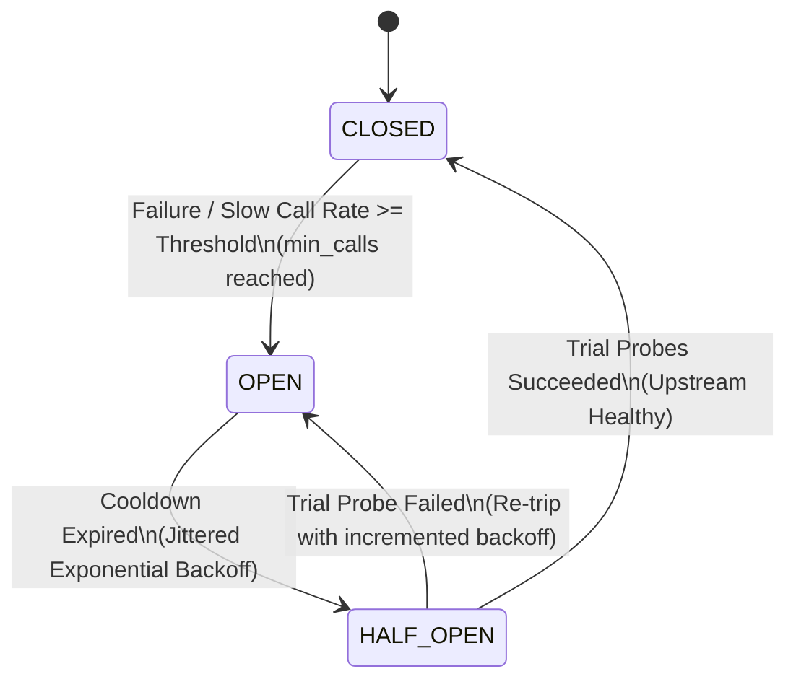

# Sentinel Circuit Breaker

[](https://github.com/Sodototive95/sentinel-circuit-breaker/actions/workflows/ci.yml)
[](https://www.python.org/)
[](https://opensource.org/licenses/MIT)

A zero-dependency, production-grade **Circuit Breaker and Concurrency Bulkhead** library in modern Python. Designed for distributed systems resilience, preventing cascading failures, and safeguarding upstream services under degraded conditions.

## Architectural Overview

The Circuit Breaker models system stability using a state machine that transitions between **CLOSED**, **OPEN**, and **HALF_OPEN** based on sliding-window execution metrics:



### Key Engineering Features

- **Dual Synchronous & Asynchronous Support**: Transparently decorates both synchronous `def` and asynchronous `async def` routines, or acts as a standard/async context manager.
- **Sliding-Window Failure Analytics**: Dual-mode window combining count-based circular ring buffering with time-based sample expiration to accurately estimate instantaneous failure and slow-call rates.
- **AWS-Style Jittered Exponential Backoff**: Implements Full Jitter, Equal Jitter, and Decorrelated Jitter (based on Marc Brooker's AWS Architecture research) to eliminate the "thundering herd" problem during service recovery.
- **Bulkhead Concurrency Isolation**: Protects host capacity and thread pools by enforcing strict concurrency caps with instant fast-rejection when limits are exceeded.
- **Structured Telemetry & Event Bus**: Observable lifecycle hooks (`StateChangeEvent`, `CallSuccessEvent`, `CallFailureEvent`, `CircuitRejectedEvent`) for zero-overhead integration with Prometheus, Datadog, or OpenTelemetry.
- **Zero External Dependencies**: Pure Python standard library implementation (`asyncio`, `threading`, `collections`, `dataclasses`).

---

## Installation

```bash
git clone https://github.com/Sodototive95/sentinel-circuit-breaker.git
cd sentinel-circuit-breaker
pip install -e .
```

---

## Usage Examples

### 1. Asynchronous Service Protection (Decorator)

```python
import asyncio
import httpx
from circuit_breaker import CircuitBreaker, CircuitOpenError

api_circuit = CircuitBreaker(
    name="payment-gateway",
    failure_rate_threshold=0.5,    # Trip if >= 50% of requests fail
    min_calls_threshold=5,         # Require 5 samples before tripping
    recovery_timeout_seconds=5.0,  # Cooldown before half-open probing
)

@api_circuit
async def process_transaction(user_id: str, amount: float) -> dict:
    async with httpx.AsyncClient() as client:
        response = await client.post("https://api.gateway.internal/charge", json={"user": user_id, "amt": amount})
        response.raise_for_status()
        return response.json()

async def main():
    try:
        result = await process_transaction("user_102", 99.50)
        print("Transaction approved:", result)
    except CircuitOpenError as err:
        print("Fast-failing request: upstream gateway is currently unavailable.", err)
```

### 2. Synchronous Context Manager with Bulkhead Isolation

```python
from circuit_breaker import CircuitBreaker, Bulkhead

db_bulkhead = Bulkhead(name="db-pool", max_concurrent=5)
db_circuit = CircuitBreaker(
    name="primary-database",
    bulkhead=db_bulkhead,
    expected_exceptions=[ConnectionError, TimeoutError],
    ignored_exceptions=[ValueError],  # Validation errors do NOT count toward failure rate
)

def query_records(query_id: int):
    with db_circuit:
        # Executes within both circuit protection and bulkhead concurrency bounds
        return execute_heavy_sql(query_id)
```

### 3. Subscribing to Lifecycle Events (Telemetry / Metrics)

```python
from circuit_breaker import CircuitBreaker, StateChangeEvent, CircuitRejectedEvent

circuit = CircuitBreaker("inventory-service")

def telemetry_observer(event):
    if isinstance(event, StateChangeEvent):
        print(f"[ALERT] Circuit {event.circuit_name}: {event.old_state} -> {event.new_state} (Reason: {event.reason})")
    elif isinstance(event, CircuitRejectedEvent):
        print(f"[METRIC] Request rejected by circuit {event.circuit_name}. Retry after {event.retry_after:.1f}s")

circuit.add_listener(telemetry_observer)
```

---

## Configuration Reference

| Parameter | Type | Default | Description |
| :--- | :--- | :--- | :--- |
| `name` | `str` | *Required* | Identifier used in logging and metric events |
| `failure_rate_threshold` | `float` | `0.5` | Ratio of failed calls (0.0 - 1.0) required to trip the circuit |
| `slow_call_rate_threshold` | `float` | `0.8` | Ratio of slow calls required to trip the circuit |
| `slow_call_threshold_ms` | `float` | `1000.0` | Execution duration in ms considered "slow" |
| `min_calls_threshold` | `int` | `10` | Minimum sample count before error rate is evaluated |
| `recovery_timeout_seconds`| `float` | `10.0` | Initial cooldown duration before entering `HALF_OPEN` |
| `half_open_max_calls` | `int` | `3` | Number of trial probes allowed in `HALF_OPEN` state |
| `backoff_strategy` | `JitterStrategy` | `FULL` | Jitter algorithm: `NONE`, `FULL`, `EQUAL`, `DECORRELATED` |
| `max_backoff_seconds` | `float` | `120.0` | Maximum ceiling for exponential backoff delay |
| `bulkhead` | `Bulkhead` | `None` | Optional concurrency limiter to prevent resource exhaustion |

---

## Testing

The test suite validates state transitions, sliding window ring-buffer eviction, jitter mathematical distributions, and high-concurrency race conditions:

```bash
python3 -m unittest discover -s tests -p "test_*.py" -v
```

---

## License

MIT License. Designed and maintained by Joel Rand.
